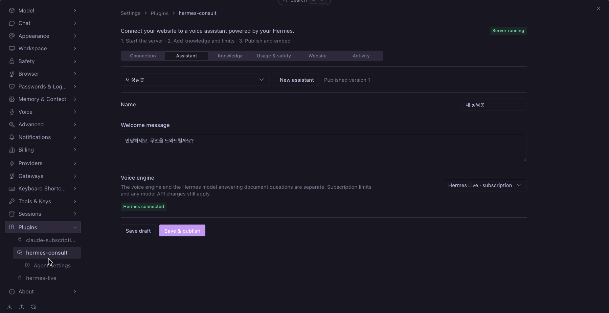
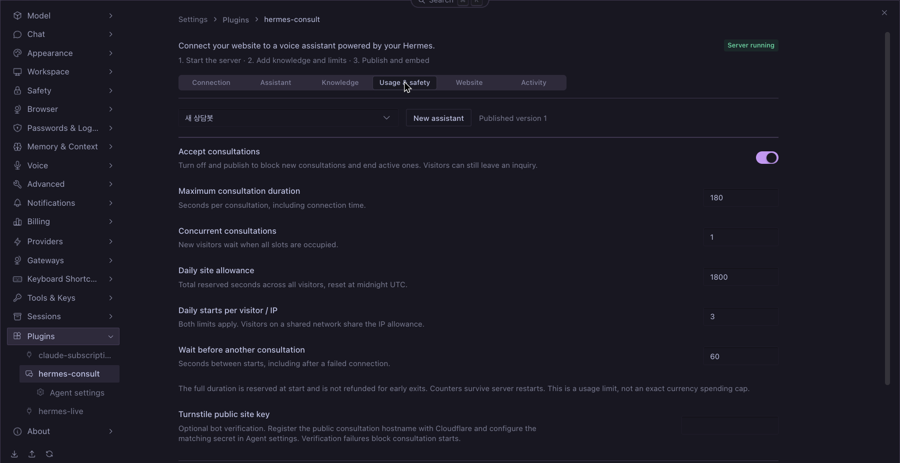

# hermes-consult

**Hermes Desktop에서 설정하고 홈페이지에 삽입하는 음성 상담 플러그인입니다.**

English: [README.md](./README.md)

회사·상품 자료와 답변 규칙을 등록하고 삽입 코드를 홈페이지에 넣으면, 방문자가 음성·텍스트로 상담하거나 문의를 남길 수 있습니다. 플러그인에 상담 서버가 포함되며 별도 커넥터를 설치하거나 연결 코드를 입력할 필요가 없습니다.

설정 패널은 Hermes 기본 디자인 시스템을 사용하고 앱 언어에 따라 영어·한국어로 전환됩니다. 백엔드 오류는 로캘 키와 영어 문구로 전달되어 패널 언어로 표시됩니다. 상담봇마다 **답변 언어**를 정할 수 있고, 기본값 *자동*은 홈페이지의 `<html lang>` 언어로 답합니다(방문자가 다른 언어를 쓰면 그 언어로 답합니다). 방문자 위젯의 버튼·양식 문구는 아직 한국어 중심입니다.

## 화면 미리보기

Hermes 기본 UI를 사용하는 설정 패널입니다. 영어·한국어를 지원하며, 아래 영문 화면의 한국어 상담봇 이름과 인사말은 편집 가능한 예시 데이터입니다.





## 준비 사항

- Hermes Agent·Desktop **0.22.5 이상**. 상담을 제공할 프로필에서 플러그인을 활성화하세요.
- 서버를 실행할 컴퓨터의 **Node.js 24 이상**. 빌드된 서버와 Desktop UI가 포함되어 있습니다.
- 플러그인의 로컬 포트로 연결되는 **공개 HTTPS 주소**. 도메인과 HTTPS 터널·리버스 프록시는 직접 준비합니다.
- 직접 호출 방식의 Hermes 답변 모델. 자체 도구를 실행하는 에이전트 전송 방식은 차단합니다.
- 음성은 **공식 GPT-Live API 키와 잔액**, 또는 **Hermes Live 0.9.1 이상과 Codex ChatGPT 로그인** 중 하나를 사용합니다.

## 설치

### 방법 A — 로컬 소스 연결

```sh
git clone https://github.com/dandacompany/hermes-consult.git ~/src/hermes-consult
mkdir -p ~/.hermes/plugins
ln -s ~/src/hermes-consult ~/.hermes/plugins/hermes-consult
hermes plugins enable hermes-consult --no-allow-tool-override
```

기존 플러그인 폴더를 덮어쓰지 마세요. 소스를 수정했다면 `npm ci && npm run build`로 다시 빌드합니다.

### 방법 B — Hermes 설치 명령

```sh
hermes plugins install dandacompany/hermes-consult
hermes plugins enable hermes-consult --no-allow-tool-override
```

구독 음성을 사용하려면 companion 플러그인도 설치하거나 업데이트하세요.

```sh
hermes plugins install dandacompany/hermes-live
hermes plugins enable hermes-live --no-allow-tool-override
```

### 설치 확인

```sh
hermes plugins list
hermes plugins doctor ~/.hermes/plugins/hermes-consult --ci
```

Desktop의 **기능 → 플러그인**에서 다시 검색하고 Hermes Consult의 Desktop 기능도 켜세요. **설정 → 플러그인 → hermes-consult**에서 설정합니다. 이미 로드된 Python 백엔드를 업데이트했다면 진행 중인 작업을 마친 뒤 게이트웨이를 재시작하세요.

## 홈페이지에 연결하기

1. **연결**에서 공개 HTTPS 주소와 로컬 포트를 입력하고 서버를 시작합니다. 구독 방식이면 구독 음성을 허용합니다.
2. **상담봇**을 만들고 음성 엔진·자료·답변 규칙·사용 한도를 설정합니다.
3. **홈페이지**에 허용 주소를 등록합니다. www 주소는 별도로 등록하고 저장·게시합니다.
4. **홈페이지 → 삽입 코드 복사**를 누릅니다. 코드 전체를 홈페이지 관리자에게 전달하거나 공통 HTML의 `</body>` 앞에 넣습니다.
5. 홈페이지의 버튼을 눌러 음성 시작과 마이크 허용을 확인합니다.

```html
<script src="https://consult.example.com/widget.js" data-site-id="site_YOUR_ID" async></script>
```

스니펫에는 공개 상담 주소와 공개 사이트 ID만 들어갑니다. API 키·OAuth 토큰·내부 Hermes 주소는 포함하지 않습니다. 공개 상담 주소와 WebRTC 연결 상대 정보는 개발자 도구에서 확인할 수 있습니다.

컴퓨터와 Hermes가 켜져 있어야 상담을 받을 수 있습니다. 설정과 자료는 보존되며 서버를 시작하면 게시된 상담봇이 자동으로 연결됩니다. 서버 시작은 명시적으로 실행하며 OS 부팅 시 자동 실행 서비스는 포함하지 않습니다.

### 스니펫 전달과 운영

- 위 예시의 주소와 ID는 자리표시자입니다. 실제로는 선택한 상담봇의 패널에서 생성된 코드를 그대로 복사하세요. 홈페이지 관리자에게 Hermes 로그인이나 API 키를 전달할 필요는 없습니다.
- CMS·홈페이지 빌더는 스크립트를 허용하는 공통 HTML 또는 푸터 코드 입력란을 사용합니다. 일반 글쓰기 블록에서는 코드가 실행되지 않고 글자로 표시될 수 있습니다. 방문자는 Hermes 플러그인을 설치하지 않습니다.
- **홈페이지**에 `https://www.example.com`처럼 정확한 출처 주소를 등록합니다. `https://example.com`도 사용한다면 별도로 등록하세요. 상담 서버는 방문자의 브라우저에서 접근할 수 있는 공개 HTTPS 주소가 필요합니다. `localhost`는 로컬 테스트용입니다.
- 자료·규칙·한도 변경은 **저장하고 게시**하면 적용됩니다. 스니펫을 다시 넣을 필요는 없습니다. 상담 서버 주소나 사이트 ID가 달라지면 스니펫을 교체하세요. 같은 상담봇을 여러 허용 도메인에 넣으면 사이트 전체 사용 한도를 공유합니다.
- 설치 후 플로팅 버튼, 마이크 허용, 등록 자료에 근거한 질문 한 건, 문의 접수를 확인하세요. **활동 기록**에서 문의와 사용 기록을 봅니다. 버튼이 안 보이면 `widget.js` 로딩을, 통화가 실패하면 서버 상태·허용 주소·사용 한도·마이크 및 CSP 권한을 확인하세요.

## 설정 항목

| 메뉴 | 기능 |
| --- | --- |
| 연결 | HTTPS 주소·포트·구독 허용·서버 시작/중지 |
| 상담봇 | 이름·첫 인사·음성 엔진 |
| 자료·규칙 | TXT/Markdown 가져오기, 자료 최대 40,000자, 답변 규칙 |
| 사용량·보호 | 일시 중지·최대 시간·동시 접속·일일 시간·방문자/IP별 횟수·대기 시간·Turnstile |
| 홈페이지 | 허용 주소·게시·삽입 코드 |
| 활동 기록 | 접수 문의·상담 사용 기록 |

`HERMES_CONSULT_OPENAI_API_KEY`와 선택 사항인 `HERMES_CONSULT_TURNSTILE_SECRET`은 Hermes 비밀정보 설정 또는 플러그인의 **에이전트 설정**에서 관리하세요. 공식 API는 기존 `OPENAI_API_KEY`도 사용할 수 있습니다. 키 변경 후 상담 서버를 재시작하고, 키를 스니펫이나 상담 자료에 넣지 마세요.

Turnstile을 사용하려면 **공개 상담 호스트**(위젯 iframe의 주소)를 Cloudflare에 등록하고 공개 사이트 키와 해당 비밀 키를 설정하세요. 서버는 검증 성공·호스트·동작·상담 사이트를 확인하며 실패하거나 토큰이 없으면 상담 시작을 거부합니다. [Cloudflare 공식 문서](https://developers.cloudflare.com/turnstile/get-started/server-side-validation/)를 참고하세요. CSP에서 Cloudflare 검증 스크립트·프레임도 허용해야 합니다.

홈페이지 CSP에서 상담 주소의 script·frame·connection을 허용하고, Permissions-Policy에서 iframe 마이크 사용을 허용해야 합니다.

## 사용량 보호

기본값은 **상담당 3분, 동시 상담 1개, 사이트 하루 30분, 방문자·IP별 하루 3회, 다음 시작까지 60초**입니다. 서버에서 강제로 적용하며 SQLite에 저장되어 재시작해도 초기화되지 않습니다. 상담 접수를 끄고 게시하면 진행 중인 상담도 종료합니다.

일일 한도는 UTC 자정 기준입니다. 시작 시 최대 시간을 예약하고 실패·조기 종료에도 반환하지 않습니다. 보수적인 사용량 제한이며 정확한 금액 상한은 아닙니다. 구독 음성도 무제한·무료로 보장하지 않으며, 자료 답변에 쓰는 Hermes 모델에 별도 API 비용이 발생할 수 있습니다.

브라우저 저장소 삭제나 IP 변경으로 방문자 식별을 우회할 수 있어 사이트 전체 한도와 봇 검증을 함께 사용합니다. **전달된 IP 헤더는 신뢰하지 않습니다.** 터널·프록시 뒤에서는 방문자가 프록시 IP 한도를 공유할 수 있으므로 엣지에서도 사용량 제한을 설정하세요. 전달 헤더를 무조건 신뢰하도록 변경하지 마세요. 유료 엔진으로 자동 전환하지 않습니다.

## 보안과 현재 범위

- 서버는 `127.0.0.1`에만 바인딩합니다. Desktop 모드의 관리 API는 외부 접근을 거부하며 인증된 플러그인 백엔드만 메모리상의 제어 토큰으로 접근합니다.
- 프로필별 데이터 디렉터리를 분리합니다. 프로필마다 별도 포트를 쓰고 공개 상담에는 전용 프로필 또는 격리된 호스트를 사용하세요.
- 상담 모델은 Hermes 도구·메모리·SOUL·작업폴더 지침 없이 실행됩니다. 구독 음성의 shell·MCP·앱·플러그인·훅도 비활성화합니다. 이는 OS 샌드박스를 대신하지 않습니다.
- 조회된 답변만 발화하도록 지시하지만 사실 오류·프롬프트 노출을 완전히 막는 장치는 아닙니다. 자료와 규칙에 비밀정보를 넣지 마세요.
- 상담 서버는 음성·질문 내용을 보관하지 않습니다. 명시적으로 제출한 문의와 상담 사용 기록은 30일, 해시 처리한 방문자/IP 카운터는 서버 실행 중 최대 2일 보관합니다. 외부 AI 제공자의 정책은 별도입니다.
- 단일 Node 프로세스와 SQLite 기반입니다. 다중 서버, PDF 파싱, 벡터 검색, 상담원 통화 인계, 결제·환불 실행, 이메일 알림은 포함하지 않습니다.
- 구독 음성 → 자료 조회 → 음성 답변까지 실제 통화로 확인했습니다. 공식 API는 잔액이 있는 계정으로 최종 통화 검증이 필요합니다. 공개 HTTPS 배포와 부하 시험은 아직 완료하지 않았습니다.
- 자료 답변은 공개 플러그인 LLM 인터페이스(`ctx.llm.complete`)만 사용하며 Hermes 내부 모듈을 import하지 않습니다.

## 빌드

```sh
npm ci
npm run typecheck
npm run build
```

`dist/server.mjs`와 `desktop/plugin.js`가 빌드 결과이며 소스도 함께 제공합니다. Python 의존성은 `plugin.yaml`에 선언되어 있습니다.

## 출처와 라이선스

구독 음성은 [Hermes Live](https://github.com/dandacompany/hermes-live)와 연동합니다. 별도 실행용 커넥터에는 MIT 라이선스 브로커의 수정본도 포함됩니다. [NOTICE.md](./NOTICE.md)와 [THIRD_PARTY_NOTICES.txt](./THIRD_PARTY_NOTICES.txt)를 참고하세요.

[MIT](./LICENSE) © 2026 Dante Labs.

---
[Dante Labs](https://dante-labs.com) · [YouTube](https://youtube.com/@dante-labs) · [Email](mailto:dante@dante-labs.com) · [Discord](https://discord.com/invite/rXyy5e9ujs) · [후원](https://buymeacoffee.com/dante.labs)

## 실행·외부 통신 안내

- 활성화 시 `consult` CLI 명령과 Desktop 설정 페이지를 등록합니다. 에이전트 도구·훅·미들웨어, 코어 수정, 자체 업데이트는 없습니다.
- 서버 시작 시 Node 프로세스와 커넥터 스레드가 실행됩니다. 자료 답변은 제한시간·토큰 상한이 있는 Hermes 호스트 소유 `ctx.llm.complete` 호출 한 번이며 도구·메모리·세션과 제공자·모델·프로필 재지정이 없습니다. 셸 문자열은 실행하지 않고 인자 배열을 사용합니다. Node 자식 프로세스와 Codex 앱 서버는 Hermes 환경 복사본이 아니라 허용 목록 환경(Codex: `PATH`, `HOME`, `USER`, `LANG`/`LC_*`, 임시 디렉터리, `CODEX_HOME`/XDG 디렉터리, 프록시·CA 변수)만 받으므로 Hermes가 불러온 봇 토큰 등 비밀 값이 전달되지 않습니다.
- 외부 접근은 `ctx.llm`을 통한 현재 프로필의 모델, 그리고 구독 음성을 켠 경우 **같은 프로필**에 설치된 Hermes Live 연동 모듈뿐입니다(다른 프로필의 사본은 불러오지 않습니다). 구독 음성은 Codex 앱 서버를 실행하고 계정·유효 설정을 조회합니다. 로그인은 Codex가 관리하며 이 플러그인이 인증 파일을 직접 읽지는 않습니다.
- 음성·연결 신호는 OpenAI로, 질문·게시 자료는 설정한 Hermes 모델 제공자로 전송됩니다. 선택 기능인 Turnstile은 Cloudflare 리소스를 로드하고 `challenges.cloudflare.com`에 검증 토큰을 보냅니다. 분석·텔레메트리는 수집하지 않습니다.
- `<HERMES_HOME>/consult/`의 `consult.sqlite`에 자료·문의·사용량, `settings.json`에 비밀이 아닌 서버 설정을 저장합니다. 키는 Hermes의 프로필별 `get_secret`으로만 조회합니다. Node 자식 프로세스에는 선택한 Turnstile 비밀키가 환경변수로 전달되며 공개 위젯에는 전달되지 않습니다. 로컬 제어 토큰은 메모리에만 있습니다.

## 공식 카탈로그 등록 상태

현재는 GitHub에서 직접 설치하는 커뮤니티 플러그인이며 **공식 카탈로그 승인 상태가 아닙니다**. [등록 규정](https://github.com/NousResearch/hermes-agent/blob/main/plugin-catalog/README.md)을 기준으로 다음 사항이 남아 있습니다.

- 구독 음성은 사용자가 설치한 Codex CLI와 그 CLI의 로그인을 사용합니다. 인증 파일을 직접 읽거나 복사·갱신하지 않고 Hermes 코어를 패치하지 않습니다. [Hermes Live 카탈로그 검토](https://github.com/NousResearch/hermes-agent/pull/143585#issuecomment-6388816635)에서 관리자는 `ad9a770e` 버전의 이 방식을 명시적으로 수용했습니다. 따라서 이를 확정적인 규정 11번 위반으로 취급하지 않고 기존 구조를 유지하며 외부 프로세스 실행을 공개합니다. 이 피드백이 Hermes Consult나 이후 버전의 자동 승인을 뜻하지는 않습니다.
- 자료 답변은 문서화된 `ctx.llm.complete`를 요청 형태 인자만으로 호출하므로 라우팅·인증·폴백은 Hermes가 담당합니다. Hermes 내부 모듈 import, 코어 수정, 몽키패치가 없습니다.
- 검증 통과가 등록 승인은 아닙니다. [카탈로그 PR #148521](https://github.com/NousResearch/hermes-agent/pull/148521)에 UI 스크린샷과 전체 40자리 커밋 SHA를 고정한 항목을 제출했으며, 제출이 승인을 의미하지는 않습니다. 기존 피드백은 연동 방식의 검토 근거이며 전체 규정의 면제를 뜻하지 않습니다.

## 의존성 정책

Python 의존성에는 호환 하한·상한을 두고 Hermes 코어 제약 안에서 검증합니다. JavaScript는 lockfile과 CI의 `npm ci`를 사용하고 읽을 수 있는 번들의 재현성을 확인합니다. 업데이트 시 원본 변경을 검토하며 자동 배포 연령 격리는 아직 없습니다. 네이티브 실행파일·바이트코드·불투명한 압축파일은 배포하지 않습니다.
