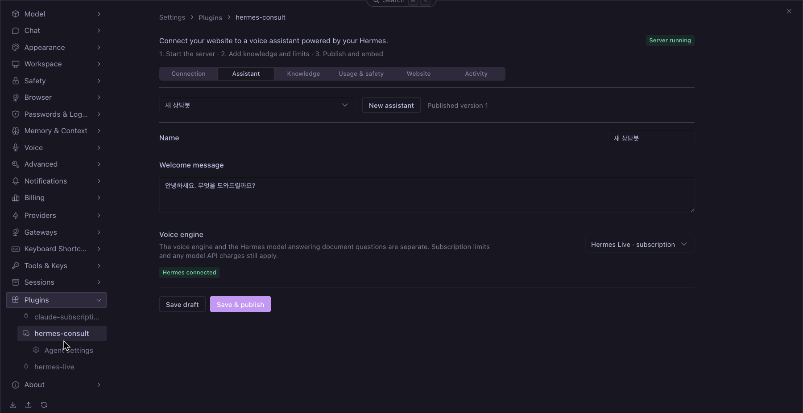
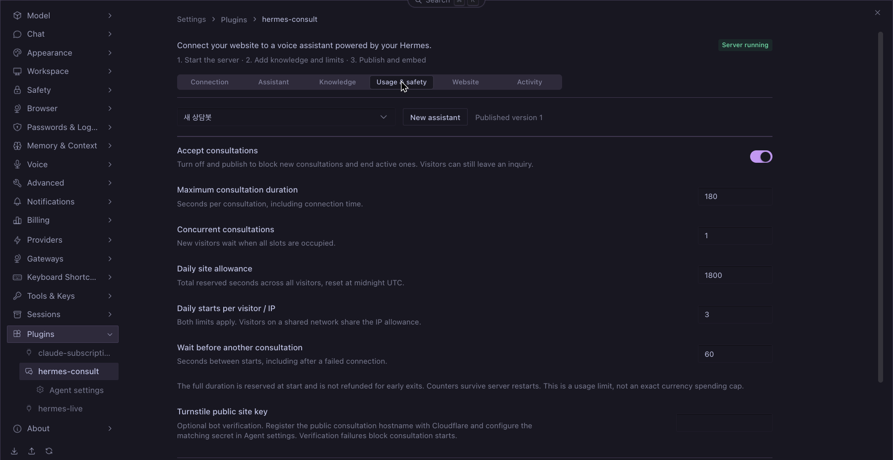

# hermes-consult

**Embed a voice consultation assistant on your website, managed from Hermes Desktop.**

한국어 문서: [README.ko.md](./README.ko.md)

Hermes Consult adds a settings panel and a self-hosted consultation server to Hermes. Configure business knowledge, answer rules, allowed websites and usage limits, then copy a script tag into your website. Visitors can speak to the assistant, type questions or leave an inquiry.

The Desktop panel follows Hermes settings components and switches between English and Korean with the app language; backend errors reach it as locale keys with English text. Each assistant has an **Answer language** setting: the default, *Automatic*, answers in the embedding page's `<html lang>` (or the visitor's own language when it differs). The visitor widget, consultation window, demo page and standalone web admin are available in English and Korean. The widget follows the assistant's fixed answer language, otherwise the page's `<html lang>` (Korean for `ko*`, English for everything else); the web admin follows the browser language and has a toggle. Relay errors carry a stable `code` with English `error` text, and the browser shows them in its own language.

## Screenshots

The native Desktop panel supports English and Korean. The Korean assistant name and greeting below are editable sample content.





## Requirements

- Hermes Agent and Desktop **0.22.5 or later**, with the plugin enabled on the serving profile.
- **Node.js 24 or later** on that host. Prebuilt server and Desktop bundles are included.
- A public **HTTPS origin** routed to the plugin's loopback listener. Provision your own HTTPS reverse proxy or tunnel; the plugin does not create a domain or tunnel.
- A configured Hermes model using a direct provider transport. Native agent transports with their own tools are rejected.
- Voice: either an OpenAI key with GPT-Live API access and available credit, or **Hermes Live 0.9.1+** with the consultation integration and an existing Codex ChatGPT login.

## Install

### Option A — local checkout

```sh
git clone https://github.com/dandacompany/hermes-consult.git ~/src/hermes-consult
mkdir -p ~/.hermes/plugins
ln -s ~/src/hermes-consult ~/.hermes/plugins/hermes-consult
hermes plugins enable hermes-consult --no-allow-tool-override
```

Do not overwrite an existing plugin directory. For development, run `npm ci && npm run build` after editing source files.

### Option B — Hermes installer

```sh
hermes plugins install dandacompany/hermes-consult
hermes plugins enable hermes-consult --no-allow-tool-override
```

For subscription voice, also install or update the companion plugin:

```sh
hermes plugins install dandacompany/hermes-live
hermes plugins enable hermes-live --no-allow-tool-override
```

### Verify

```sh
hermes plugins list
hermes plugins doctor ~/.hermes/plugins/hermes-consult --ci
```

In Desktop, open **Capabilities → Plugins**, rescan, and enable the Desktop half of **Hermes Consult**. Open **Settings → Plugins → hermes-consult**. If upgrading an already-loaded Python backend, restart the gateway after active work finishes.

## Quick start

1. In **Connection**, set the public HTTPS origin and local port. Enable subscription voice if using Hermes Live. Start the server.
2. Create an assistant. Choose the voice engine, add consultation knowledge and answer rules, and configure usage limits.
3. In **Website**, register each allowed website origin, including `www` separately. Save and publish.
4. In **Website**, click **Copy snippet**. Send the complete code to your website administrator, or paste it into your website's shared HTML before `</body>`.
5. On the website, open the floating button, start voice and allow microphone access.

```html
<script src="https://consult.example.com/widget.js" data-site-id="site_YOUR_ID" async></script>
```

The embed code contains only a public origin and public site ID. API keys, OAuth credentials and the private Hermes host address are not included. The public consultation origin and WebRTC peer information remain visible in browser developer tools.

Keep Hermes and its host running. Server settings and assistant data persist; starting the server reconnects published assistants automatically. The internal connector is managed by the plugin—there is no separate pairing step in Desktop mode. Server start is explicit, not an unattended boot service.

### Deliver and maintain the snippet

- Use the code generated for the selected assistant; the example above contains placeholders. The website administrator needs only this code, not access to Hermes or your keys.
- For a CMS or website builder, use its site-wide custom HTML/footer-code field that permits scripts. A normal text block may display the code instead of running it. Visitors do not install a Hermes plugin.
- Register the exact website origin, such as `https://www.example.com`, in **Website**. Include `https://example.com` separately if both are used. The consultation server needs a public HTTPS address reachable from visitors' browsers; `localhost` is only for local testing.
- Updating knowledge, rules or limits requires **Save & publish**, not replacing the snippet. Replace the snippet if the consultation origin or site ID changes. Reusing the same assistant on several allowed domains shares its site-wide usage allowance.
- After installation, check the floating button, microphone permission, one question grounded in your documents, and an inquiry submission. Check inquiries and usage in **Activity**. If the button is missing, check whether the page loaded `widget.js`; if calls fail, check the server status, allowed origin, limits and browser microphone/CSP permissions.

## Configuration

| Panel | Settings |
| --- | --- |
| Connection | Public origin, local port, subscription voice, start/stop |
| Assistant | Name, greeting, voice engine |
| Knowledge | TXT/Markdown import, up to 40,000 characters, answer rules |
| Usage & safety | Pause, duration, concurrency, daily seconds, visitor/IP start limit, cooldown, optional Turnstile |
| Website | Allowed origins, publish, embed code |
| Activity | Submitted inquiries and consultation usage |

Configure `HERMES_CONSULT_OPENAI_API_KEY` and optional `HERMES_CONSULT_TURNSTILE_SECRET` through Hermes secret settings / the plugin's **Agent settings**. The OpenAI lane also accepts the existing `OPENAI_API_KEY`. Restart the consultation server after changing secrets. Never place them in the embed code or consultation documents.

For Turnstile, register the **public consultation hostname** (the widget iframe origin), set its public site key in Usage & safety, and configure its matching secret. The server validates success, hostname, action and site binding; missing, expired, replayed or failed validation denies a new session. See [Cloudflare validation documentation](https://developers.cloudflare.com/turnstile/get-started/server-side-validation/). Allow the Cloudflare challenge script/frame in your content security policy.

Homepage CSP must allow the consultation origin for scripts, frames and connections. Its Permissions-Policy must permit microphone use by the widget iframe.

## Usage protection

Defaults: **3 minutes per consultation, 1 concurrent consultation, 30 minutes per site per day, 3 starts per visitor/IP per day, 60 seconds between starts**. Limits are enforced on the server and persisted in SQLite. A pause published by the administrator ends active consultations and rejects new ones.

Daily limits reset at midnight UTC. The entire maximum duration is reserved at start and is not refunded on failure or early termination. This is conservative usage accounting, not an exact monetary cap. Subscription voice is not guaranteed unlimited or free; the separate Hermes answer model may incur API charges.

Visitor storage can be cleared and network addresses can change, so per-visitor checks are layered with site-wide limits and optional bot verification. Forwarded IP headers are **not trusted**: behind a tunnel/reverse proxy, visitors may share the proxy's IP allowance. Configure appropriate edge rate limits; do not enable unrestricted forwarding-header trust. There is no paid-engine automatic fallback.

## Security and limitations

- The server binds to `127.0.0.1`. Desktop mode denies public administrative API access and uses an in-memory control credential through the authenticated Hermes plugin backend.
- Separate profiles use separate data directories and should use separate ports. Use a dedicated Hermes profile or isolated host for public consultations.
- Consultation answers run without Hermes tools, memory, SOUL or working-directory instructions. Subscription voice disables shell, MCP, plugins, apps and hooks. These application controls are **not an OS sandbox**.
- Rules and verified-answer instructions reduce mistakes but do not guarantee factual accuracy or prevent all prompt disclosure. Do not put secrets in knowledge or rules.
- Audio and question text are not retained by the consultation server. Explicit inquiries and session usage are stored locally for 30 days; hashed visitor/IP counters for up to two days while the server is running. External model providers have their own data policies.
- Single Node process + SQLite. Multi-replica deployment, PDF parsing, vector search, human call transfer, payment/refund actions and email notifications are not included.
- The subscription voice/document-answer flow has been exercised end to end. Official API voice still needs a successful funded-account E2E check. Public HTTPS deployment and load testing have not been completed.
- Document answers use only the public plugin LLM facade (`ctx.llm.complete`); no private Hermes modules are imported.

## Execution and network disclosure

- Enabling the plugin registers a `consult` CLI command and a Desktop settings page. It does not register agent tools, hooks or middleware, modify Hermes core, or update its own code.
- Starting the server launches the bundled JavaScript with the host's Node executable and keeps connector threads running until stopped. Each document answer is one host-owned `ctx.llm.complete` call with a timeout and token cap; it carries no tools, memory or session, and no provider/model/profile override. Commands use argument arrays, not a shell. The Node child and the Codex app-server receive allowlisted environments (Codex: `PATH`, `HOME`, `USER`, locale `LANG`/`LC_*`, temp directories, `CODEX_HOME`/XDG directories, proxy and CA variables), never a copy of Hermes's environment, so bot tokens and other secrets Hermes loaded do not reach either binary.
- Outside this repository, it uses the active profile's model through `ctx.llm` and, when subscription voice is enabled, loads the Hermes Live consultation module installed in the **same** profile only (never another profile's copy). The subscription broker launches the installed Codex app-server and queries its account/effective configuration. Codex manages its own login; this plugin does not read credential files.
- Website requests reach your consultation origin. Audio/voice signaling reaches OpenAI; document questions and published context reach the configured Hermes model provider. Optional Turnstile loads Cloudflare resources in the visitor iframe and sends verification tokens to `challenges.cloudflare.com`. There is no analytics or telemetry collection.
- Profile data lives under `<HERMES_HOME>/consult/`: `consult.sqlite` (business data, inquiries, usage) and `settings.json` (non-secret server settings). API keys are resolved only with Hermes's profile-scoped `get_secret`; the Node child receives the optional Turnstile secret in its process environment. The public widget never receives these secrets. Local control tokens are generated in memory.

## Catalog status

This is a community plugin distributed directly from GitHub, **not an approved Hermes catalog entry**. See the [official admission rules](https://github.com/NousResearch/hermes-agent/blob/main/plugin-catalog/README.md).

The optional subscription lane uses the user's installed Codex CLI and its own login, directly or through Hermes Live. It does not read, copy or refresh credential files, and does not patch Hermes core. In the [Hermes Live catalog review](https://github.com/NousResearch/hermes-agent/pull/143585#issuecomment-6388816635), a Hermes maintainer explicitly accepted this CLI-owned login approach when reviewing Hermes Live at `ad9a770e`. We retain that architecture and disclose the external process instead of treating it as an established rule 11 violation. That review applies to the cited Hermes Live revision, not automatic approval of Hermes Consult or subsequent revisions.

Document answers use the documented `ctx.llm.complete` facade with request-shaping arguments only, so Hermes owns routing, credentials and fallback. No internal Hermes module is imported, and no Hermes core edit or monkey-patch is required.

A passing validator is not catalog approval. [Catalog PR #148521](https://github.com/NousResearch/hermes-agent/pull/148521) includes UI screenshots and a catalog entry with a full 40-character release SHA; submission is not approval. The existing Hermes Live feedback is supporting evidence for the transport choice, not a blanket exemption from catalog rules.

## Dependency policy

Python dependencies have both a compatible lower bound and an upper bound and must resolve within Hermes core constraints. JavaScript dependencies are fixed by `package-lock.json`; CI uses `npm ci` and verifies reproducible readable bundles. Review upstream changes before updating either set. There is currently no automated dependency-age quarantine. No native executable, bytecode or opaque archive is shipped.

## Build

```sh
npm ci
npm run typecheck
npm run build
```

The package includes a bundled Node server in `dist/server.mjs`, Desktop UI in `desktop/plugin.js`, and the source used to build both. Python dependencies are declared in `plugin.yaml`.

## Attribution and license

Subscription voice integrates with [Hermes Live](https://github.com/dandacompany/hermes-live). The standalone connector also retains an adapted MIT-licensed broker. See [NOTICE.md](./NOTICE.md) and [THIRD_PARTY_NOTICES.txt](./THIRD_PARTY_NOTICES.txt) for attribution and bundled dependency licenses.

[MIT](./LICENSE) © 2026 Dante Labs.

---
Built by [Dante Labs](https://dante-labs.com) · [YouTube](https://youtube.com/@dante-labs) · [Email](mailto:dante@dante-labs.com) · [Discord](https://discord.com/invite/rXyy5e9ujs) · [Support](https://buymeacoffee.com/dante.labs)
